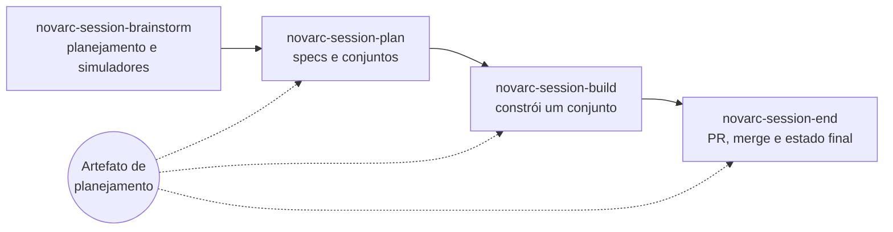

# novarc-dev

Skills da [NOVARC Sistemas](https://www.novarcsistemas.com) para Claude Code. Elas levam uma ideia até o merge:
planejamento com simuladores fiéis à interface real, specs no repositório, construção com revisão de plano,
verificação, PR, merge e o estado final de volta no artefato de planejamento.

> Este repositório é gerado automaticamente a partir de uma linha estável do repositório interno da NOVARC. Não abra
> pull request aqui: ele seria sobrescrito na próxima publicação. Sugestões e problemas vão para o seu contato na NOVARC.

## O que vem no plugin

| Skill | Quando usar | O que faz |
|---|---|---|
| `novarc-session-brainstorm` | `/novarc-session-brainstorm`, "planeja isso", "simula essa tela" | Brainstorm, simuladores fiéis à interface real, `plano.json` com mudanças, decisões e pendências, publicado como artefato de planejamento no claude.ai. |
| `novarc-session-plan` | `/novarc-session-plan <link>` | Lê o artefato e o repositório, corta as mudanças em specs agrupados em conjuntos, grava os specs no repositório e escreve o prompt de cada conjunto. |
| `novarc-session-build` | `/novarc-session-build conjunto <link> C01` | Constrói um conjunto de specs: plano revisado, implementação, testes e a branch publicada, registrando cada marco no artefato de planejamento. |
| `novarc-session-end` | `/novarc-session-end` | Fecha a branch (PR, merge, limpeza) e devolve ao artefato o estado final de cada spec: merge, PR, desvios e pendências. |
| `novarc-codex-review` | Chamada pelo build em todo plano; `/novarc-codex-review` à mão | Revisão adversarial do plano com o Codex, em modo só leitura, até ele aprovar. |

## Como funciona



1. `novarc-session-brainstorm` publica o planejamento como um artefato no claude.ai.
2. `novarc-session-plan` escreve os specs no seu repositório, em `.novarc/specs/<codigo>/`, e põe no artefato um
   prompt pronto para cada conjunto.
3. Cole o prompt do conjunto numa sessão nova do Claude Code aberta no repositório. Cada conjunto roda sozinho.
4. Ao terminar, rode `/novarc-session-end`.

**Acesso ao artefato.** O build e o end gravam os marcos no banco do artefato de planejamento, então o artefato
precisa estar compartilhado com a conta do claude.ai de quem roda as sessões, com permissão de edição. As regras do `CLAUDE.md` do seu
repositório sempre valem acima das skills: se ele exigir autorização para push, PR ou merge, as skills pedem.

## Instalação

**Antes de começar:** Claude Code 2.1.293 ou mais novo e Node.js (as ferramentas do planejamento rodam nele). Para a revisão de plano, o
[Codex CLI](https://github.com/openai/codex) instalado e autenticado numa conta com acesso ao modelo `gpt-6-sol`,
que a `novarc-codex-review` fixa em toda rodada. Sem ele, a revisão para e avisa; fale com a NOVARC antes de começar
o primeiro conjunto.

No prompt do Claude Code:

1. Adicione o marketplace:

   ```
   /plugin marketplace add NovArc-Sistemas/novarc-dev
   ```

2. Instale o plugin no escopo de usuário:

   ```
   /plugin install novarc@novarc-dev
   ```

3. Ligue a atualização automática: `/plugin` → **Marketplaces** → **novarc-dev** → **Enable auto-update**. Para
   marketplaces que não são da Anthropic, ela vem desligada.

4. Abra uma sessão nova, ou rode `/reload-plugins`. As skills aparecem como `novarc:novarc-session-build` e
   assim por diante.

## Atualizações

Cada publicação da NOVARC é uma versão nova: o `plugin.json` não fixa número de versão, então o Claude Code usa o
commit como versão. Com a atualização automática ligada, a versão nova chega sozinha e vale na sessão seguinte. Para
atualizar na hora: `/plugin` → Marketplaces → novarc-dev → Update, e depois `/reload-plugins`.

## Licença

MIT. Veja [LICENSE](LICENSE).
